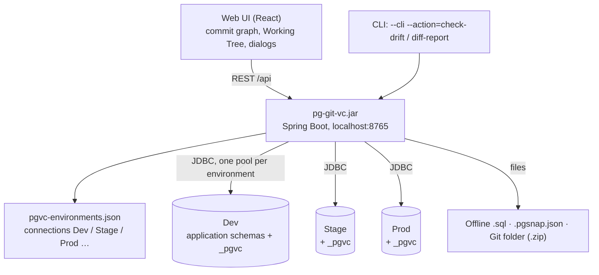
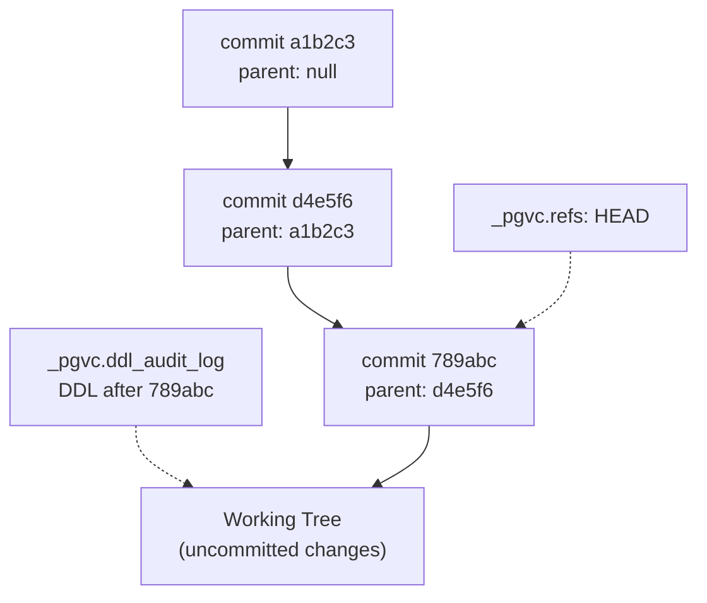
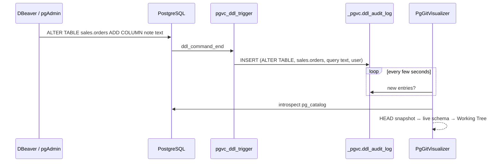
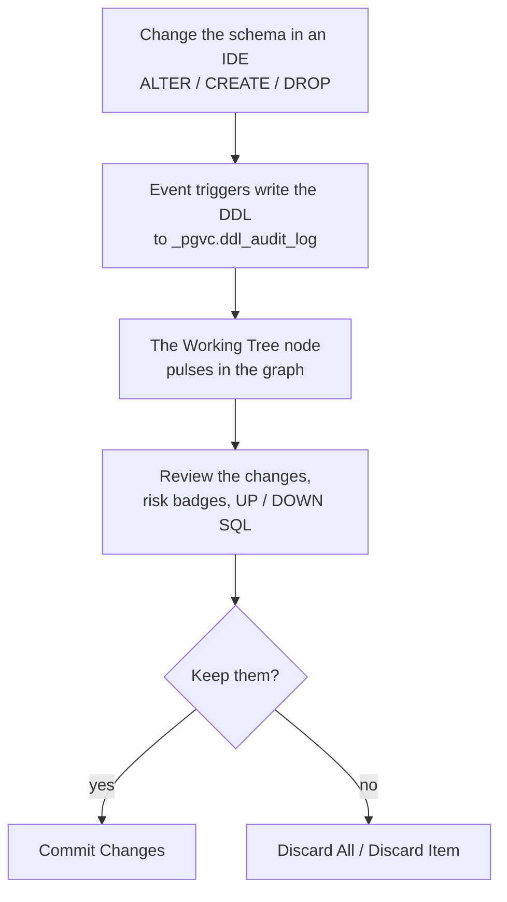
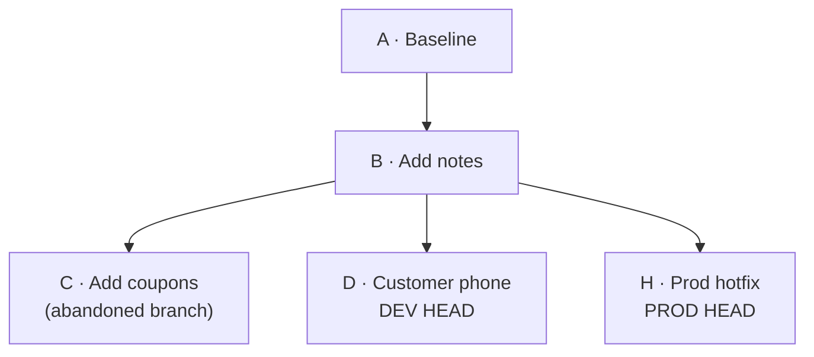
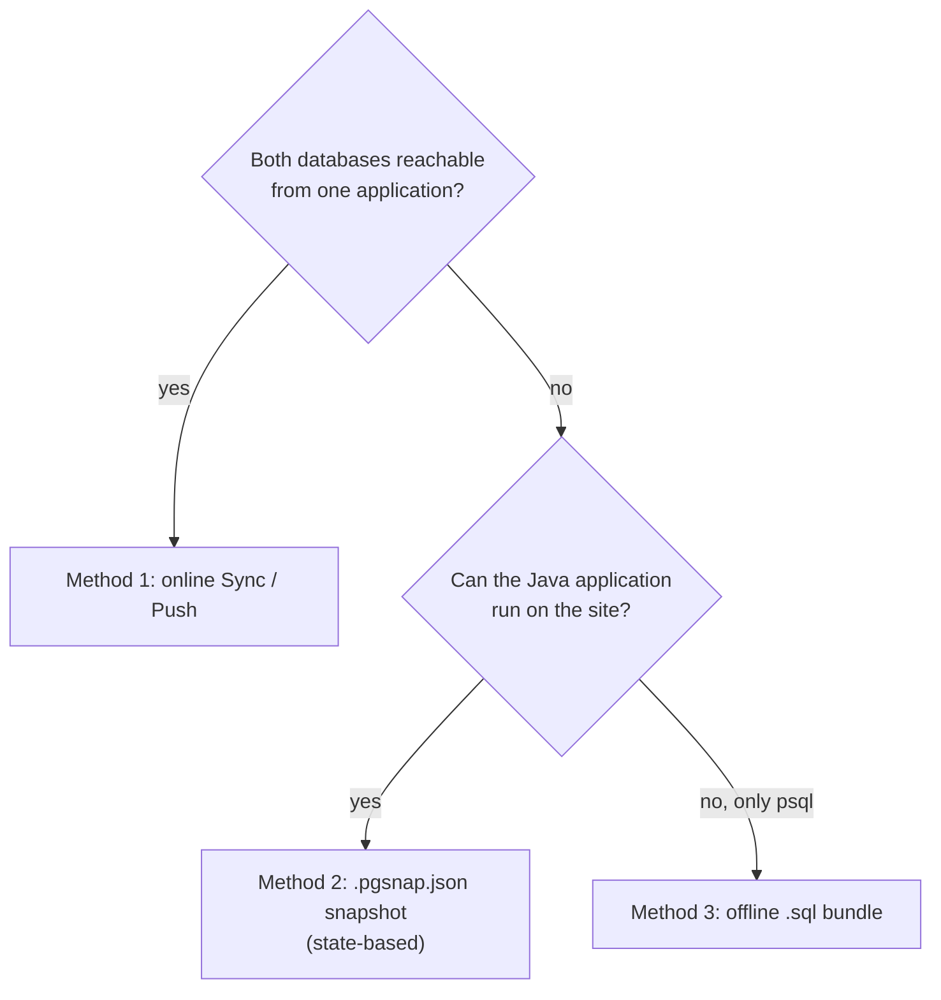
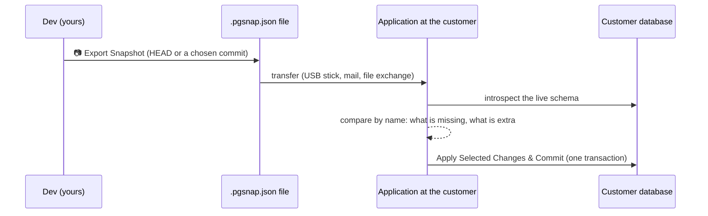
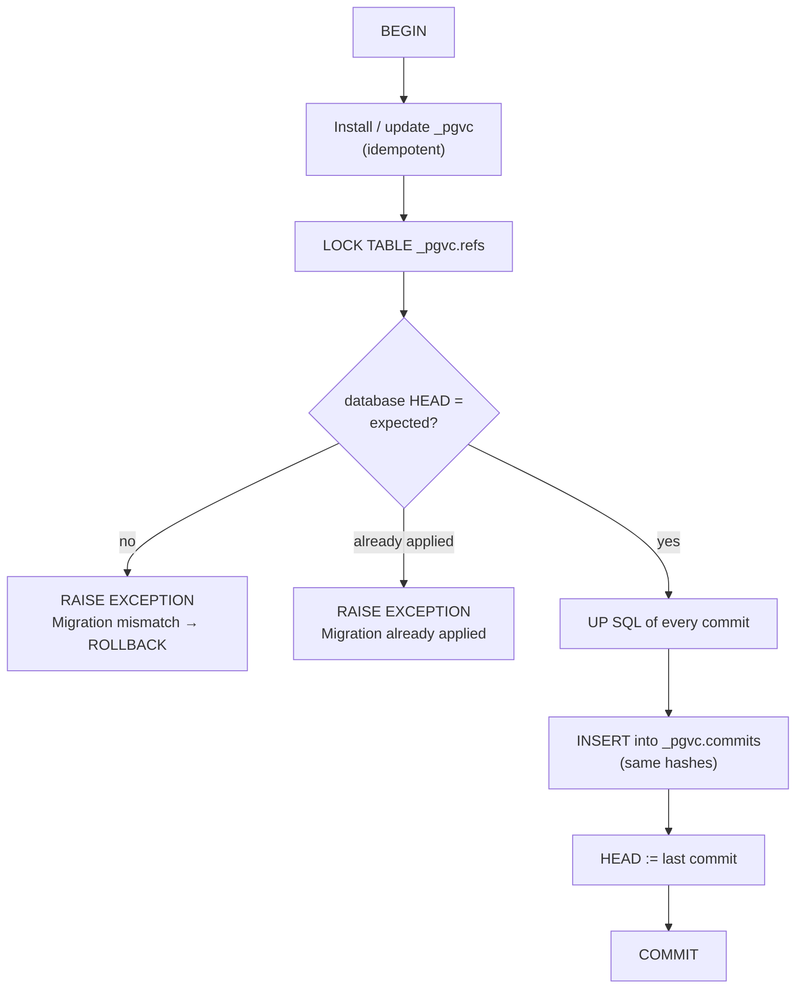

# PgGitVisualizer — User and Architecture Manual

Version 1.9.1. Русская версия: [MANUAL_RU.md](MANUAL_RU.md). REST API, formats and internal algorithms (in
Russian): [TECHNICAL.ru.md](TECHNICAL.ru.md).

The same manual is built into the UI: the **📖 Docs** button in the top bar (works offline — on an isolated site the
single `.jar` is enough).

## Contents

1. [Architecture](#1-architecture)
   1.1. [Components](#11-components) · 1.2. [The `_pgvc` schema](#12-the-_pgvc-schema) ·
   1.3. [Event triggers](#13-event-triggers-capturing-ddl) · 1.4. [Why `pg_catalog`](#14-why-the-introspector-reads-pg_catalog-and-not-information_schema) ·
   1.5. [Commit, snapshot and hash](#15-commit-snapshot-and-hash)
2. [Everyday developer work](#2-everyday-developer-work-workflow-a-and-b)
   2.1. [First start](#21-first-start) · 2.2. [Workflow A: external IDE + Working Tree](#22-workflow-a-changes-in-an-external-ide-committed-through-the-working-tree) ·
   2.3. [Workflow B: New SQL Migration](#23-workflow-b-a-migration-through-new-sql-migration) ·
   2.4. [Discarding uncommitted changes](#24-discarding-uncommitted-changes-safely)
3. [Branches and history](#3-branches-and-history)
   3.1. [What a branch is](#31-what-a-branch-is-in-pggitvisualizer) · 3.2. [Switching](#32-switching-between-environments-and-branches) ·
   3.3. [Rollback](#33-rolling-a-database-back-to-a-commit) · 3.4. [Revert Commit](#34-reverting-one-commit-revert-commit) ·
   3.5. [Context menu](#35-commit-context-menu) · 3.6. [Deleting commits and branches](#36-deleting-commits-and-branches)
4. [Playbook: shipping changes to a customer](#4-playbook-shipping-changes-to-an-external-customer)
   4.1. [Choosing a method](#41-choosing-a-method) · 4.2. [Online Sync](#42-method-1-online-sync--push) ·
   4.3. [`.pgsnap.json` snapshot](#43-method-2-state-based-sync-with-pgsnapjson) ·
   4.4. [Offline `.sql`](#44-method-3-self-registering-offline-sql-bundle)
5. [Troubleshooting](#5-troubleshooting)
6. [More](#6-more)

---

## 1. Architecture

### 1.1. Components

PgGitVisualizer is one Spring Boot application (`pg-git-vc-<version>.jar`) with an embedded React UI. No Docker, no
separate metadata database, no agents on servers: the version history of every database is stored **in that
database**, in the `_pgvc` schema.



Inside the application:

| Component | What it does |
|---|---|
| `EnvironmentManagerService` | the environment list (`pgvc-environments.json`), a connection pool per environment |
| `PgVcStorageService` | installs `_pgvc`, reads and writes commits, `HEAD`, the DDL log |
| `PostgresSchemaIntrospector` | reads the complete schema from `pg_catalog` into a `DatabaseSnapshot` |
| `SchemaDiffEngine` | compares two snapshots: the list of changes and UP / DOWN scripts in a dependency-safe order |
| `MigrationSafetyAnalyzer` | estimates locks, table rewrites, data loss and duration |
| `VersionControlService` | commits, Mode B, rollback, discard, push, linking environments |
| `OfflineMigrationService`, `SnapshotSyncService` | offline `.sql` bundles and `.pgsnap.json` snapshots |

### 1.2. The `_pgvc` schema

**Initialize version control** (or `POST /api/environments/{id}/pgvc/initialize`) creates the `_pgvc` schema once.
The script is idempotent: it can run again.

| Table | Purpose |
|---|---|
| `_pgvc.commits` | the commit graph: `hash` (SHA-256), `parent_hash`, `author`, `message`, `created_at`, `up_sql`, `down_sql`, `schema_snapshot` (the full schema as JSONB), `ddl_log_history` (the DDL that went into the commit) |
| `_pgvc.refs` | named pointers; the `HEAD` row is the commit the database is at |
| `_pgvc.ddl_audit_log` | DDL captured by the triggers since the last commit: command, object, query text, user, time |
| `_pgvc.tracked_data_tables` | reference-data tables whose rows are version controlled too |



> **Warning.** Do not edit the `_pgvc` tables by hand. A commit hash is computed from its content, and `HEAD` must
> point at an existing commit. If the schema was touched anyway, see [5.4](#54-manual-changes-to-the-_pgvc-schema).

### 1.3. Event triggers: capturing DDL

Initialization creates two **event triggers** — database-level triggers that fire on DDL of any user:

| Trigger | Event | Function | What it records |
|---|---|---|---|
| `pgvc_ddl_trigger` | `ddl_command_end` | `_pgvc.fn_log_ddl_end()` | every command of `pg_event_trigger_ddl_commands()`: `CREATE`, `ALTER`, `COMMENT`, `GRANT` … |
| `pgvc_drop_trigger` | `sql_drop` | `_pgvc.fn_log_sql_drop()` | dropped objects of `pg_event_trigger_dropped_objects()` (only those named in the command) |

The functions are `SECURITY DEFINER`: they run with the rights of the superuser who installed them, so DDL of ordinary
developers is logged instead of failing with `permission denied for schema _pgvc`; `db_user` keeps the real login
(`session_user`). Objects of `_pgvc` itself, temporary tables and TOAST are not logged.



> **Tip.** The DDL log tells who changed what. The source of truth of the Working Tree is the comparison of the
> `HEAD` snapshot with the live schema: changes made without the triggers (e.g. while a trigger was disabled) show up
> too.

Installing the triggers needs a **SUPERUSER** (that is how PostgreSQL event triggers work). Afterwards the database
can be used with an ordinary role.

### 1.4. Why the introspector reads `pg_catalog` and not `information_schema`

`information_schema` is a standard but reduced view. For version control it is not enough:

| Needed | `information_schema` | `pg_catalog` |
|---|---|---|
| Tell a rename from drop + create | no OIDs | `pg_class.oid` survives `RENAME`, `pg_attribute.attnum` survives `RENAME COLUMN` |
| Partitions and their bounds | not shown as partitions | `relkind = 'p'`, `pg_inherits`, `pg_get_expr(relpartbound)` |
| Exact definitions | partly | `pg_get_constraintdef`, `pg_get_indexdef`, `pg_get_viewdef`, `pg_get_functiondef`, `pg_get_triggerdef` |
| Objects the current role cannot see | hidden | all visible |
| Materialized views, ENUMs, extensions, identity, generated | missing or partial | available |

All introspection queries run in one read-only `REPEATABLE READ` transaction — the snapshot is consistent. Objects of
extensions (`pg_depend.deptype = 'e'`) and the `_pgvc` schema are skipped.

OIDs and attnums are compared **only within one database of one environment** (snapshot identity
`system_identifier:database_oid@environment`). Between environments objects are matched strictly by name.

### 1.5. Commit, snapshot and hash

Every commit stores:

- `up_sql` — how to get from the parent to this commit;
- `down_sql` — how to go back (used by rollbacks);
- `schema_snapshot` — the full schema after the commit (tables, columns, constraints, indexes, views, sequences,
  functions, triggers, ENUMs, extensions, comments, reference-data rows);
- `ddl_log_history` — the DDL the triggers captured before the commit.

The hash is SHA-256 of parent, author, message, time, SQL and snapshot. A commit pushed to Stage and Prod has **the
same hash** in every database — that is how the graph knows where each environment is.

---

## 2. Everyday developer work (Workflow A and B)

### 2.1. First start

1. **Start the application:** `java -jar pg-git-vc-1.9.1.jar` and open http://localhost:8765.
2. **Add an environment:** **Environments → Add environment**: name, badge color, **Host**, **Port**, user, password
   → **Load databases**. The databases of the server (with comments) appear on the left, the schemas of the
   picked database on the right: tick the ones to track or keep **All schemas** (schemas created later are tracked
   too) → **Test connection** → **Save**. A multi-host connection or special parameters use the **JDBC URL** mode
   (`jdbc:postgresql://host:5432/db?sslmode=require`).
3. **Initialize:** on the yellow bar "Version control is not set up in … yet" press **Initialize version control**
   (needs a SUPERUSER).
4. **First commit (baseline):** an existing schema shows up as the **Working Tree (Uncommitted Changes)** node with
   all objects. Select it and press **Commit Changes** with the message "Baseline". The database is now under
   version control.

> **Warning.** Connections are stored in `pgvc-environments.json` next to the jar, passwords in plain text. Do not
> publish this file or add it to Git. By default the application listens on `127.0.0.1` only.

### 2.2. Workflow A: changes in an external IDE, committed through the Working Tree

For teams used to changing the schema in DBeaver, pgAdmin, DataGrip or with their own migration tools.



1. **Change the schema** in any IDE, for example:

   ```sql
   ALTER TABLE sales.customers ADD COLUMN phone varchar(32);
   CREATE INDEX customers_phone_idx ON sales.customers (phone);
   ```

2. **Look at the Working Tree.** **Working Tree (Uncommitted Changes) · N changes** appears on top of the graph, and
   the **Live DDL Audit Log** panel lists the captured commands. Click the node: on the right are the changes (A —
   added, M — modified, R — renamed, D — deleted), safety badges and the **UP SQL** / **DOWN SQL** tabs.
3. **Edit the SQL if needed,** e.g. add `USING` to a column type change or replace an index creation with
   **⚡ Use Zero-Downtime Pattern**. The changes are already in the database: committing only **records** them, it does
   not execute anything.
4. **Commit:** press **Commit Changes…**, fill in **Author**, **Commit summary** (one line, shown in the graph) and
   optionally **Commit description** (details, ticket number; line breaks are kept), then **Commit Changes** (or
   Ctrl+Enter). `HEAD` moves, the DDL log is cleared. The description is shown in the commit panel and in the tooltip
   when hovering over the commit in the graph.

> **Warning.** When a table, partition or column was already dropped in the live database (e.g. in DBeaver), the
> Working Tree marks it **💀 Data ALREADY lost in DB**: its rows are gone for good, and **Discard All Changes (Reset to
> HEAD)** runs `CREATE` / `ALTER` and brings back only an empty structure. In scripts that still have to run (sync,
> snapshot, rollback, revert) the same change is marked **⚠️ Data will be lost on apply**.

> **Tip.** Renames are recognised by OID / attnum: `ALTER TABLE … RENAME` becomes a `RENAME`, not "drop and create
> again" with data loss.

**Grouping and the SQL of a change.** By default the list is grouped by table (**🗂️ Group by Entity / Dependencies**
next to the search; **📄 Flat List** shows no groups): "📦 mnemo_schemes (6 related changes: scada, mdc, public)"
collects the tables of that name in every schema, their columns, indexes, constraints and sequences, the foreign keys
of other tables that reference them and views. The group checkbox selects all its changes, the counters show what was
added, modified and deleted, a click on the header collapses the group. An expanded change shows **UP**, **⚡
Zero-downtime pattern (UP)**, **DOWN** and **⚡ Zero-downtime rollback pattern (DOWN)** (foreign keys and CHECKs are
re-added as `NOT VALID` + `VALIDATE CONSTRAINT`, indexes `CONCURRENTLY`), each with **📋 Copy SQL** (the
`-- pgvc:step` lines are not copied). **⚡ Use in Editor** puts both patterns into the UP SQL and DOWN SQL tabs.

> **Warning.** After `CREATE TABLE mdc.t (LIKE scada.t INCLUDING ALL)` the `id` column of the new table keeps taking
> numbers from `scada.t_id_seq`. The Working Tree shows "⚠️ Column id of mdc.t uses the sequence of another schema
> (scada.t_id_seq), possibly copied by CREATE TABLE LIKE!" and a **Quick fix**: SQL that creates `mdc.t_id_seq` (when
> it is missing), continues after the existing rows and changes the `DEFAULT`. Copy it or run it with **▶ Apply to
> database** (no commit: the fix then shows up in the Working Tree).

### 2.3. Workflow B: a migration through New SQL Migration

For changes written as a migration that must be executed and committed atomically.

1. **Open the dialog:** **New SQL Migration (Mode B)** in the top bar.
2. **Write the UP SQL.** The **safety analysis** on the right updates as you type: risk level (SAFE / WARNING /
   DANGEROUS), lock mode, table size, duration estimate; dangerous operations offer a zero-downtime pattern.
3. **DOWN SQL** may stay empty: it is generated from the schema difference.
4. **Pre-Script / Post-Script** run before and after the UP SQL (e.g. `SET search_path`, `ANALYZE`).
5. **Timeouts:** `lock_timeout` (default 3s) and `statement_timeout` (60s) are applied with `SET LOCAL`.
6. **🧪 Dry-Run (Test in Rollback Transaction)** runs the script on the real database in a transaction that is rolled
   back: you see whether it passes and how long it takes.
7. **Execute & Commit** — UP SQL, introspection and the commit record in one transaction. Any error rolls back
   everything.

```sql
-- step 1: an ordinary transaction
ALTER TABLE billing.ledger ADD COLUMN account_ref bigint;
-- pgvc:step
-- step 2: outside of a transaction (CONCURRENTLY cannot run inside one)
CREATE INDEX CONCURRENTLY ledger_account_ref_idx ON billing.ledger (account_ref);
```

> **Warning.** A `-- pgvc:step` line splits the migration into steps, each step is its own transaction. If step 2
> fails, step 1 is already applied: it shows up as an uncommitted change.

> **Danger.** `BEGIN` / `COMMIT` / `ROLLBACK` inside the SQL are refused — the application manages transactions.

When the database already has uncommitted changes, the migration is refused. "Also include uncommitted changes that are
already in the database" makes them part of this commit.

### 2.4. Discarding uncommitted changes safely

The equivalent of `git reset --hard HEAD` / `git checkout -- <file>`.

- **🗑️ Discard All Changes (Reset to HEAD)** — the button in the Working Tree panel. Returns the database to `HEAD`
  (to an empty schema when there are no commits yet).
- **Discard / Revert Item** — the ↶ icon next to every change. Reverts only that change.

```mermaid
sequenceDiagram
    participant U as User
    participant UI as Discard dialog
    participant S as Server
    participant DB as Database
    U->>UI: Discard All / Discard Item
    UI->>S: discard-plan (which changes)
    S->>DB: HEAD snapshot ↔ live schema
    S-->>UI: revert SQL + safety analysis
    U->>UI: reviews / edits the SQL
    UI->>S: discard
    S->>DB: BEGIN; revert SQL; check "schema = HEAD"; clear the DDL log; COMMIT
    S-->>UI: done (or rolled back on any error)
```

1. **Open the dialog.** It shows what is reverted, the risk and the revert SQL.
2. **Read the warnings.** A table created after `HEAD` is dropped **with its data**. A dropped column comes back, but
   **empty**: its data cannot be restored.
3. **Edit the SQL if needed** right in the editor.
4. **Confirm.** Everything runs in one transaction. After a full reset the application checks that the schema equals
   `HEAD` again and clears the DDL log. A partial discard keeps your log entries and removes only those of the
   discard itself.

> **Tip.** If stale events are stuck in the DDL log while the schema is fine, use **Only clear the DDL log** in the
> same dialog (or `POST /api/vc/working-tree/clear-log?envId=…`).

---

## 3. Branches and history

### 3.1. What a branch is in PgGitVisualizer

> **Important.** There are **no** named branches like `git branch feature-x`: every database has one history and one
> `HEAD` pointer. A "branch" is a line in the graph that appears by itself.

A branch appears in two cases:

1. **After a rollback.** The database was rolled back to commit B, then a new commit D was made. Commit C, which came
   after B, stays in the history — the graph forks.
2. **When environments diverge.** A hotfix was made directly on Prod while Dev moved on with other commits. They share
   an ancestor but continue on different lines.



Environment badges (DEV, STAGE, PROD …) show where the `HEAD` of every database is. The graph is shared: commits of
all environments are merged by hash.

### 3.2. Switching between environments and branches

- **Switch the environment** with the selector on the left of the top bar or by **double clicking an environment
  badge** in the graph (tooltip "Double click — switch to environment …"). The Working Tree, Schema Explorer and DDL
  log show the selected database; the badge of the active one reads "● DEV". Next to the selector — the quick picker
  of the tracked schemas of the active database; next to Refresh — how long it took ("Refreshed in 120 ms").
- **Moving a database to another line** is not one button (it would set the schema to an arbitrary commit). The
  sequence is:
  1. **Rollback** to the common ancestor (the commit where the lines fork);
  2. **Sync / Push** from the environment whose line has the wanted commit: the missing commits are applied.
- **When environments diverged** (`Diverged`), a push is not possible. Decide whose line is right: roll back the extra
  commits and push the right ones, or link the environment to the other history (**Link**, section
  [4.2](#42-method-1-online-sync--push)).

### 3.3. Rolling a database back to a commit

1. **Select a commit** in the graph — an ancestor of the current `HEAD` of the active environment.
2. **Press Rollback DB to here.** The rollback script opens: the `down_sql` of every commit after the selected one,
   newest first. It can be edited.
3. **Confirm with Roll back database.** Script, verification and the `HEAD` move are one transaction.

```mermaid
sequenceDiagram
    participant S as Server
    participant DB as Database
    S->>DB: BEGIN; SET LOCAL lock_timeout / statement_timeout
    S->>DB: down_sql of commit E, then D (newest → oldest)
    S->>DB: introspect: schema = snapshot of commit C ?
    alt equal
        S->>DB: HEAD := C; clear the DDL log; COMMIT
    else difference or error
        S->>DB: ROLLBACK (nothing changed)
    end
```

> **Warning.** A rollback does not delete commits: they stay as an abandoned branch that can be pushed again or
> deleted. Data of columns and tables dropped by the rollback is not restored.

> **Tip.** With uncommitted changes in the database the rollback is refused. Commit or discard them first, or enable
> "Allow uncommitted changes".

### 3.4. Reverting one commit (Revert Commit)

Like `git revert <hash>`: undoes the changes of **one** commit — even from the middle of the history — with a **new
commit** on top of `HEAD`, leaving the commits after it alone. A rollback ("Rollback DB to here") returns the whole
chain, Revert only the chosen commit.

1. Right-click the commit in the graph → **Revert Commit…** (or **Revert Commit…** in the commit panel). The commit
   must be in the history of the active environment.
2. The dialog shows the compensating SQL (the DOWN SQL of the commit) in an editor: edit it if the schema changed since.
   Next to it: the safety analysis and what the commit changed.
3. Warnings: the commit dropped a table / column — Revert brings back the structure but not the rows; the commit created
   a table / column — Revert drops it with its data; later commits changed the same objects — the SQL may not fit.
4. **Revert & Commit**: SQL, schema snapshot and the new commit are one transaction, the DDL log is cleared. Default
   message `Revert "<message>"`, description "Reverts commit <hash>". The DOWN SQL of the new commit is the UP SQL of
   the reverted one (generated from the schema difference when the SQL was edited).

### 3.5. Commit context menu

Right-clicking a commit in the graph opens a menu (instead of the browser's): **Revert Commit…**, **Rollback DB to
here…**, **Create branch here…**, **Export snapshot (.pgsnap.json)**, **Export .SQL of this commit**, **Copy Commit
Hash**, **Copy Message**, **Delete Commit…**. It closes on a click outside or Escape; unavailable items are greyed out
with a tooltip saying why.

**Create branch here** — there are no named branches, so the dialog offers the two ways to start a line at this
commit: roll the active database back to it (its next commit starts the branch), or push the history up to it into
another (empty or behind) environment with **Sync / Push to Env** — "Up to commit" is preselected.

### 3.6. Deleting commits and branches

**Delete…** in the commit panel. Only commits that are **not in the current history of any environment** (not an
ancestor of any `HEAD`) can be deleted.

| Mode | What is deleted |
|---|---|
| **This commit** | the selected commit and every commit on top of it |
| **The whole branch** | the whole abandoned branch from the fork point |

The plan shows which commits are deleted from which databases. The database schemas do not change — only the
history.

---

## 4. Playbook: shipping changes to an external customer

### 4.1. Choosing a method



| | Online Sync | `.pgsnap.json` snapshot | Offline `.sql` |
|---|---|---|---|
| Network access to the customer database | yes | no | no |
| Jar on the site | no | yes | no |
| Customer history | the same, commits are copied | its own: one commit "Sync with external snapshot" | the same, commits are registered |
| Works when the customer schema has its own specifics | only through Link | yes: extra and missing objects are shown | no: an exact `HEAD` is required |
| Who applies it | you, in the application | you or the customer admin, in the application | the customer admin, with `psql` |

### 4.2. Method 1: online Sync / Push

When both databases are reachable over the network from the machine running the jar.

1. **Add the customer environment** (Environments).
2. **Open Sync / Push to Env:** choose **From (source)**, **To (target)** and, if needed, **Up to commit**.
3. **Read the status:**
   - `Behind` — can be pushed; the commits and the schema difference are listed below;
   - `Not initialized` / `Empty history` — the whole history is pushed (installing `_pgvc` needs a SUPERUSER);
   - `Diverged` — a push is not possible (see below);
   - `Ahead` / `Up to date` — nothing to push.
4. **Push.** All missing commits run in one transaction (commits with `-- pgvc:step` step by step). Afterwards the
   target schema is checked against the snapshot of the last commit.

**When the target already has the schema but no shared history (`Diverged`, or a schema without commits),** use
**Link**: the environment is attached to the commit of the source whose schema equals its live schema. No SQL is
executed. Afterwards the target is "behind" and later commits are pushed normally.

> **Tip.** **🌐 N-Database Matrix** compares several environments and snapshots with one baseline at once: it shows
> where which objects are missing.

### 4.3. Method 2: state-based sync with `.pgsnap.json`

When the customer has their own database without our history, with their own additions, and there is no network
access. The **schema state** is compared, not the history; objects are matched strictly by name.



**On Dev:**

1. **Commit everything** that has to ship.
2. **Export the snapshot:** the 📷 button in the top bar (snapshot of `HEAD`) or **Snapshot .pgsnap** in the panel of
   any commit. `snapshot_<environment>_<hash>.pgsnap.json` is downloaded.

**At the customer** (the same jar, connected to their database):

3. **Open Compare with Snapshot** and drop the file into the dialog.
4. **Go through the two groups:**
   - **Missing or different** — what the database lacks or has in another form. Selected by default.
   - **Extra in this database** (red **Destructive** badge) — objects that exist only at the customer. **Not
     selected** by default: selecting them means `DROP`.
5. **Review the SQL.** The checkboxes rebuild the UP / DOWN SQL; edit it, add pre / post scripts and timeouts, run
   **🧪 Dry-Run**.
6. **Apply: Apply Selected Changes & Commit.** The SQL runs in one transaction and is recorded as the commit "Sync with
   external snapshot [hash]" in the customer history (`_pgvc` is installed when missing).

> **Danger.** Selecting an object of **Extra in this database** drops it at the customer together with its data. The
> dialog warns "N destructive change(s) selected".

> **Tip.** To leave part of the customer objects alone (temporary tables, their own schemas), open **Ignore rules of
> this comparison** and add patterns (`tmp_%`, `customer_*`) — for this comparison only.

> **Warning.** When the PostgreSQL major versions of the snapshot and the customer database differ, the dialog shows a
> warning: run a Dry-Run.

### 4.4. Method 3: self-registering offline `.sql` bundle

When Java cannot run on the site — only an SQL file can be handed to the administrator.

1. **Open Export Offline .SQL:**
   - **Source environment** — where the commits come from;
   - **Target database is at (exclusive)** — the commit the customer database is at (or **empty** for a new
     database);
   - **Export up to (inclusive)** — up to which commit.

   For one commit there is **Export Single Commit .SQL** in its panel.
2. **Download the `.sql` file** and hand it over.
3. **The administrator runs:**

   ```bash
   psql -v ON_ERROR_STOP=1 -d app_db -f pgvc-dev-<from>-to-<to>.sql
   ```

Inside the file:



- One transaction: on any error nothing is applied.
- The bundle **registers itself**: afterwards `_pgvc.commits` holds the same commits with the same hashes as yours. The
  next bundle can start from this `HEAD`, and if network access appears later, an ordinary Sync works.
- Running it again is safe: "Migration already applied".
- `CREATE INDEX CONCURRENTLY` runs without `CONCURRENTLY` (inside a transaction it cannot).

> **Warning.** The event triggers are installed by the bundle only when a SUPERUSER runs it. Otherwise the history is
> recorded, but later DDL is not captured.

> **Warning.** On PostgreSQL 11 `ALTER TYPE … ADD VALUE` cannot run in a transaction: a bundle adding an ENUM value
> fails on version 11. Use online Sync or a snapshot.

---

## 5. Troubleshooting

### 5.1. `HEAD` conflicts

| Message | Cause | What to do |
|---|---|---|
| "HEAD moved" on commit | someone else committed in this database while you were looking at the Working Tree | refresh (↻), review the Working Tree again and commit |
| "Diverged" in Sync | the databases have no shared history or diverged after a common ancestor | Link (when the schema matches a source commit) or roll back the extra commits and push |
| "Migration mismatch: expected HEAD X, but found Y" (offline bundle) | the customer database is not at the commit the bundle was built from | build the bundle again with **Target database is at** = `Y` |
| "Migration already applied" | the bundle already ran | nothing to do |
| Push / rollback: "The target has uncommitted changes" | changes were made in the target outside of version control | commit or discard them in that database, or enable "Push even if the target has uncommitted changes" |
| "Verification failed" after a push / rollback | the schema after the run does not equal the snapshot (manual edits, server specifics) | read the differences in the message; fix the script; as a last resort enable **Skip schema verification** |

### 5.2. Table locks

Every migration, rollback, discard and push starts with `SET LOCAL lock_timeout = '3s'`: when another transaction
holds the table, the command does not wait forever but fails with "could not obtain lock … within 3s". Nothing is
applied.

1. **Find who holds the lock:**

   ```sql
   SELECT a.pid, a.usename, a.state, now() - a.xact_start AS in_transaction, left(a.query, 120) AS query
   FROM pg_stat_activity a
   WHERE a.pid IN (SELECT unnest(pg_blocking_pids(b.pid))
                   FROM pg_stat_activity b
                   WHERE cardinality(pg_blocking_pids(b.pid)) > 0);
   ```

2. **Wait for the long transaction** or end it: `SELECT pg_terminate_backend(<pid>);` (only when you are sure).
3. **Run the migration again,** with a higher `lock_timeout` if needed.
4. **Use safe patterns on big tables:** `CREATE INDEX CONCURRENTLY`, `ADD CONSTRAINT … NOT VALID` +
   `VALIDATE CONSTRAINT`, a nullable column + `CHECK … NOT VALID` instead of `SET NOT NULL`. **⚡ Use Zero-Downtime
   Pattern** inserts them for you.

> **Tip.** `statement_timeout` (default 60s) limits a single statement. For known long operations (`VALIDATE
> CONSTRAINT` on millions of rows) raise it in the migration dialog.

### 5.3. Rights and connections

| Problem | Solution |
|---|---|
| Initialize: "needs a SUPERUSER" | a superuser initializes once; afterwards an ordinary role is enough |
| DDL does not appear in the log | check the triggers: `SELECT evtname, evtenabled FROM pg_event_trigger WHERE evtname LIKE 'pgvc%';` (`D` = disabled: `ALTER EVENT TRIGGER pgvc_ddl_trigger ENABLE;`) |
| "Cannot connect" | JDBC URL, network, `pg_hba.conf`; **Test connection** shows the driver error |
| Port 8765 is busy | `java -jar pg-git-vc-1.9.1.jar --server.port=9000` |
| The UI must be opened from another machine | `--server.address=0.0.0.0` (the UI has no authentication — internal networks only) |

### 5.4. Manual changes to the `_pgvc` schema

| What happened | Symptom | What to do |
|---|---|---|
| A `_pgvc` table was dropped / renamed | the "version control is not set up" bar | **Initialize version control** restores the structure; if `_pgvc.commits` was dropped, the history is lost — make a new baseline commit |
| `HEAD` points at a commit that does not exist | "commit not found" errors | `UPDATE _pgvc.refs SET commit_hash = '<existing hash>' WHERE ref_name = 'HEAD';` and check the Working Tree |
| `up_sql` / `down_sql` were edited in `_pgvc.commits` | rollbacks do something else, hashes look foreign | do not edit commit rows; give the wanted SQL when rolling back (the script is editable) |
| The event triggers were disabled | the DDL log is empty but the Working Tree sees changes | `ALTER EVENT TRIGGER pgvc_ddl_trigger ENABLE; ALTER EVENT TRIGGER pgvc_drop_trigger ENABLE;` |
| Stale events are stuck in the log | the log is not empty although the schema is clean | **Only clear the DDL log** in the discard dialog |
| Version control must be removed from a database | — | `DROP EVENT TRIGGER IF EXISTS pgvc_ddl_trigger; DROP EVENT TRIGGER IF EXISTS pgvc_drop_trigger; DROP SCHEMA _pgvc CASCADE;` |

> **Danger.** `DROP SCHEMA _pgvc CASCADE` deletes the whole history of that database irrecoverably. Export a snapshot
> and an offline bundle first if the history may still be needed.

### 5.5. Other

- **Dropping or reordering an ENUM value** is impossible in PostgreSQL: the application shows `MANUAL ACTION
  REQUIRED`.
- **Changing the partitioning** (ordinary table ↔ `PARTITION BY`, another key) cannot be done in place in PostgreSQL:
  the application recreates the table — copies the rows into a temporary table, creates the table again with its
  partitions, puts the rows back and restores foreign keys, views and serial sequences. A row that fits no partition
  stops the whole migration (nothing changes). On big tables this takes time under an exclusive lock.
- **A reference-data table with more than 10 000 rows** is no longer compared (the list shows "over the limit").
- **After an upgrade** commits of older versions do not contain functions, triggers, ENUMs etc.: comparisons with them
  skip these categories, the first new commit records them.

---

## 6. More

- **🌐 N-Database Matrix** — many environments and snapshots against one baseline.
- **Extension versions** are not compared: an extension installed on both sides in another version (the server
  packages were updated) is not a change, and no script contains `ALTER EXTENSION … UPDATE TO`.
- **Ignore rules** (slider button) — do not compare comments, owners and grants, tablespaces, partitions, objects by
  pattern.
- **📌 Reference Data Tables** — rows of small tables under version control (`INSERT … ON CONFLICT` / `DELETE`).
- **📁 Export Git Folder** — the schema as one file per object for code review.
- **CLI for CI/CD** — `--cli --action=check-drift` (exit code 2 on drift) and `--action=diff-report` (Markdown for a
  Merge Request).

Formats and the REST API: [TECHNICAL.ru.md](TECHNICAL.ru.md).
