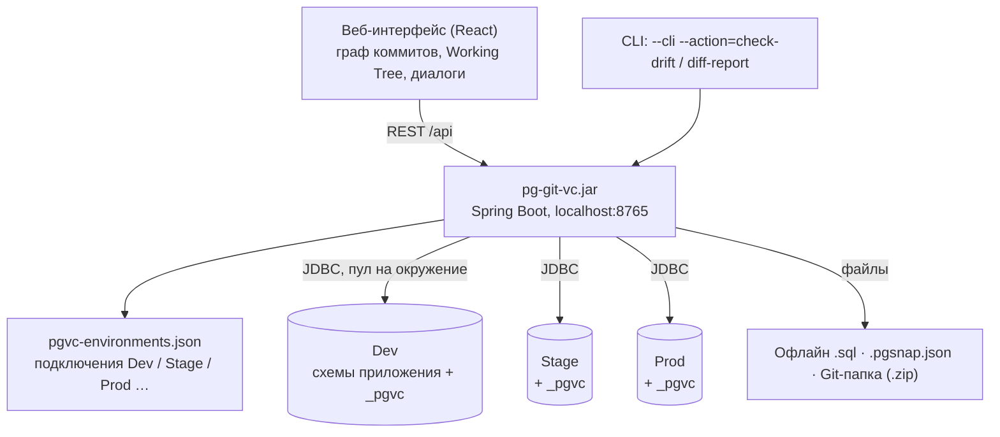
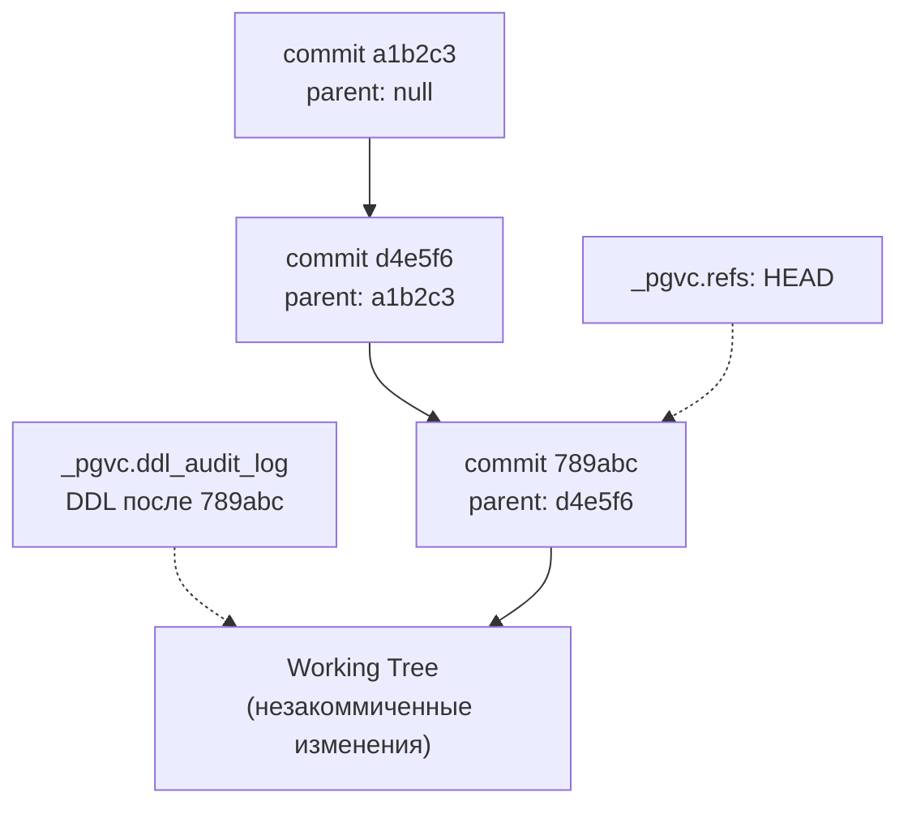
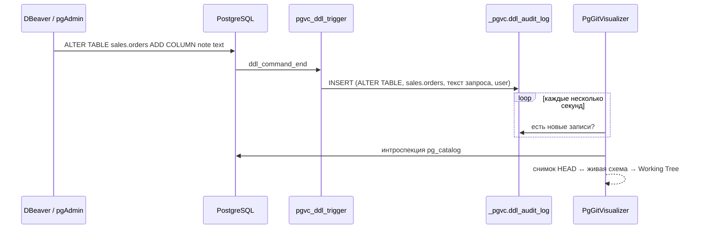
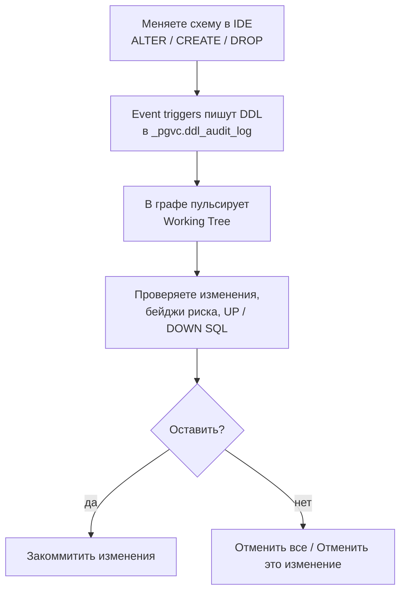
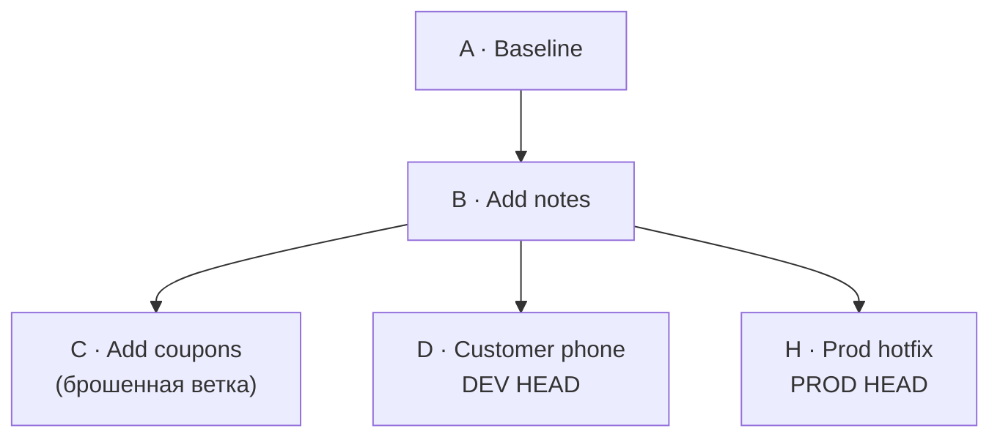
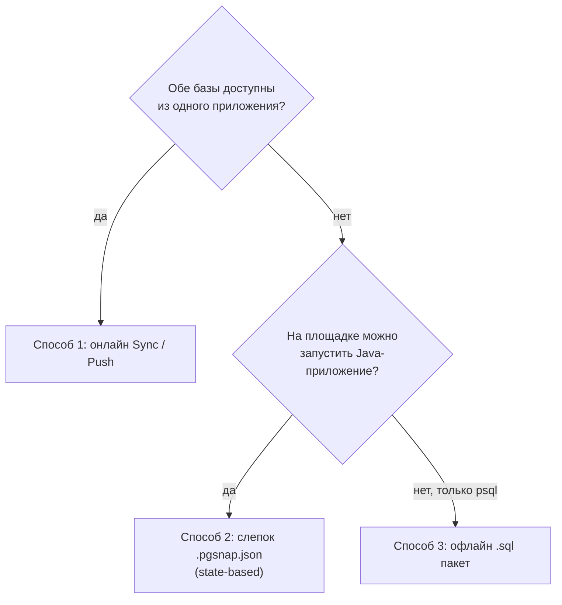
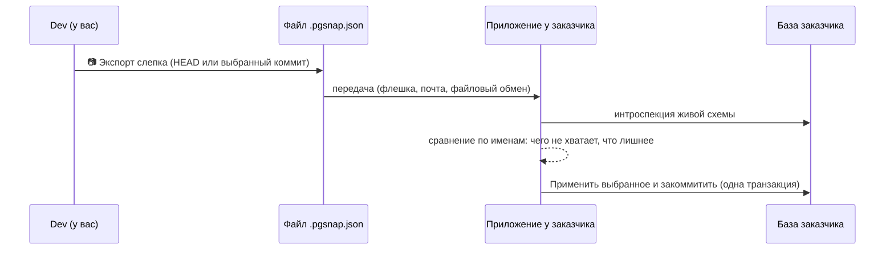
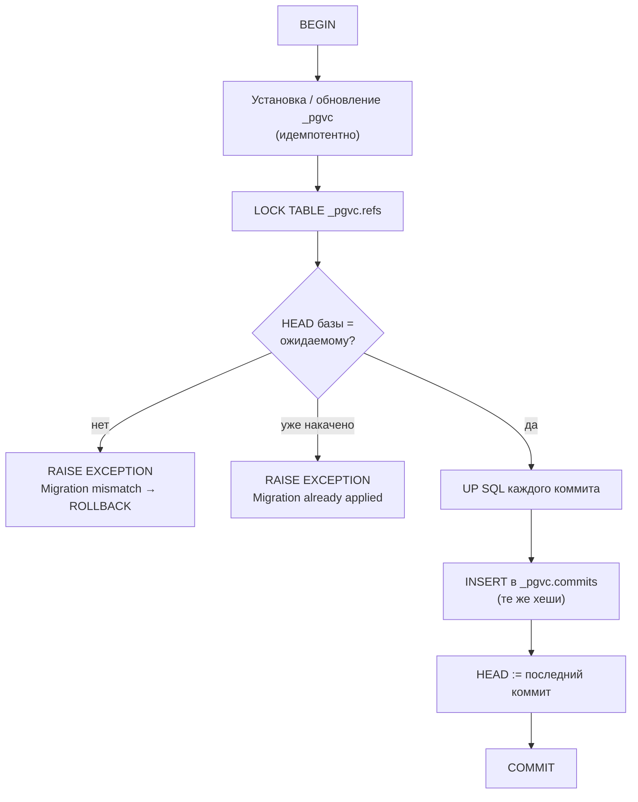

# PgGitVisualizer — руководство пользователя и архитектора

Версия 1.9.1. English version: [MANUAL_EN.md](MANUAL_EN.md). Справочник по REST API, форматам и внутренним
алгоритмам: [TECHNICAL.ru.md](TECHNICAL.ru.md).

То же руководство встроено в интерфейс: кнопка **📖 Руководство** в верхней панели (работает без интернета — на
изолированной площадке достаточно одного `.jar`).

## Содержание

1. [Внутренняя архитектура](#1-внутренняя-архитектура)
   1.1. [Компоненты](#11-компоненты) · 1.2. [Служебная схема `_pgvc`](#12-служебная-схема-_pgvc) ·
   1.3. [Event triggers](#13-event-triggers-перехват-ddl) · 1.4. [Почему `pg_catalog`](#14-почему-интроспектор-читает-pg_catalog-а-не-information_schema) ·
   1.5. [Коммит, снимок и хеш](#15-коммит-снимок-и-хеш)
2. [Ежедневная работа разработчика](#2-ежедневная-работа-разработчика-workflow-a-и-b)
   2.1. [Первый запуск](#21-первый-запуск) · 2.2. [Workflow A: внешняя IDE + Working Tree](#22-workflow-a-изменения-во-внешней-ide-и-коммит-через-working-tree) ·
   2.3. [Workflow B: New SQL Migration](#23-workflow-b-миграция-через-new-sql-migration) ·
   2.4. [Отмена незакоммиченных изменений](#24-безопасная-отмена-незакоммиченных-изменений-discard)
3. [Ветки и история](#3-ветки-и-история)
   3.1. [Что такое ветка](#31-что-такое-ветка-в-pggitvisualizer) · 3.2. [Переключение](#32-переключение-между-окружениями-и-ветками) ·
   3.3. [Откат](#33-откат-базы-к-коммиту-rollback-to-commit) · 3.4. [Revert Commit](#34-обращение-одного-коммита-revert-commit) ·
   3.5. [Контекстное меню](#35-контекстное-меню-коммита) · 3.6. [Удаление коммитов и веток](#36-удаление-коммитов-и-веток)
4. [Плейбук: перенос изменений к заказчику](#4-плейбук-перенос-изменений-к-внешнему-заказчику)
   4.1. [Как выбрать способ](#41-как-выбрать-способ) · 4.2. [Онлайн Sync](#42-способ-1-онлайн-sync--push) ·
   4.3. [Слепок `.pgsnap.json`](#43-способ-2-state-based-синхронизация-через-pgsnapjson) ·
   4.4. [Офлайн `.sql`](#44-способ-3-саморегистрирующийся-офлайн-sql-пакет)
5. [Troubleshooting](#5-troubleshooting-частые-проблемы-и-их-решение)
6. [Дополнительно](#6-дополнительно)

---

## 1. Внутренняя архитектура

### 1.1. Компоненты

PgGitVisualizer — одно Spring Boot-приложение (`pg-git-vc-<версия>.jar`) со встроенным веб-интерфейсом на React.
Docker, отдельная база для метаданных и агенты на серверах не нужны: история версий каждой базы хранится **в самой
базе**, в схеме `_pgvc`.



Внутри приложения:

| Компонент | Что делает |
|---|---|
| `EnvironmentManagerService` | список окружений (`pgvc-environments.json`), пул соединений на каждое |
| `PgVcStorageService` | установка `_pgvc`, чтение и запись коммитов, `HEAD`, журнала DDL |
| `PostgresSchemaIntrospector` | читает полную схему базы из `pg_catalog` в `DatabaseSnapshot` |
| `SchemaDiffEngine` | сравнивает два снимка, строит список изменений и скрипты UP / DOWN в безопасном порядке |
| `MigrationSafetyAnalyzer` | оценивает блокировки, перезапись таблиц, потерю данных и время выполнения |
| `VersionControlService` | коммиты, Mode B, откат, сброс, push, привязка окружений |
| `OfflineMigrationService`, `SnapshotSyncService` | офлайн-пакеты `.sql` и слепки `.pgsnap.json` |

### 1.2. Служебная схема `_pgvc`

Кнопка **Подключить контроль версий** (Initialize, или `POST /api/environments/{id}/pgvc/initialize`) один раз создаёт в базе схему `_pgvc`.
Скрипт идемпотентен: его можно запускать повторно.

| Таблица | Назначение |
|---|---|
| `_pgvc.commits` | граф коммитов: `hash` (SHA-256), `parent_hash`, `author`, `message`, `created_at`, `up_sql`, `down_sql`, `schema_snapshot` (полная схема в JSONB), `ddl_log_history` (DDL, вошедший в коммит) |
| `_pgvc.refs` | именованные указатели; строка `HEAD` — коммит, на котором сейчас находится база |
| `_pgvc.ddl_audit_log` | DDL, перехваченный триггерами после последнего коммита: тип команды, объект, текст запроса, пользователь, время |
| `_pgvc.tracked_data_tables` | таблицы-справочники, строки которых тоже под контролем версий |



> **Внимание.** Таблицы `_pgvc` не редактируются руками. Хеш коммита считается от его содержимого, а `HEAD` должен
> указывать на существующий коммит. Что делать, если схему всё-таки трогали, — в разделе
> [5.4](#54-ручное-вмешательство-в-схему-_pgvc).

### 1.3. Event triggers: перехват DDL

Инициализация создаёт два **event trigger** — триггеры уровня базы, которые срабатывают на DDL любого пользователя:

| Триггер | Событие | Функция | Что пишет |
|---|---|---|---|
| `pgvc_ddl_trigger` | `ddl_command_end` | `_pgvc.fn_log_ddl_end()` | каждую команду из `pg_event_trigger_ddl_commands()`: `CREATE`, `ALTER`, `COMMENT`, `GRANT` … |
| `pgvc_drop_trigger` | `sql_drop` | `_pgvc.fn_log_sql_drop()` | удалённые объекты из `pg_event_trigger_dropped_objects()` (только названные в команде) |

Функции объявлены `SECURITY DEFINER`: они работают с правами суперпользователя, который их установил. Поэтому DDL
обычных разработчиков логируется, а не падает с `permission denied for schema _pgvc`; в поле `db_user` при этом
остаётся настоящий логин (`session_user`). Объекты самой `_pgvc`, временные таблицы и TOAST не логируются.



> **Совет.** Журнал DDL — подсказка «кто и что менял». Источник истины для Working Tree — сравнение снимка `HEAD`
> с живой схемой: изменения, сделанные без триггеров (например, при отключённом триггере), тоже будут видны.

Для установки триггеров нужен **SUPERUSER** (так устроены event triggers в PostgreSQL). Дальше с базой можно
работать под обычной ролью.

### 1.4. Почему интроспектор читает `pg_catalog`, а не `information_schema`

`information_schema` — стандартное, но урезанное представление. Для контроля версий его не хватает:

| Нужно | `information_schema` | `pg_catalog` |
|---|---|---|
| Отличить переименование от удаления и создания | нет OID | `pg_class.oid` переживает `RENAME`, `pg_attribute.attnum` — `RENAME COLUMN` |
| Партиции и их границы | не видны как партиции | `relkind = 'p'`, `pg_inherits`, `pg_get_expr(relpartbound)` |
| Точные определения | частично | `pg_get_constraintdef`, `pg_get_indexdef`, `pg_get_viewdef`, `pg_get_functiondef`, `pg_get_triggerdef` |
| Объекты, которых не видит текущая роль | скрыты | видны все |
| Materialized view, ENUM, расширения, identity, generated | нет или частично | есть |

Все запросы интроспекции выполняются в одной read-only транзакции `REPEATABLE READ` — снимок согласован. Объекты
расширений (`pg_depend.deptype = 'e'`) и схема `_pgvc` пропускаются.

OID и attnum сравниваются **только внутри одной базы одного окружения** (идентичность снимка —
`system_identifier:oid_базы@окружение`). Между разными окружениями объекты сопоставляются строго по именам.

### 1.5. Коммит, снимок и хеш

Каждый коммит хранит:

- `up_sql` — как перейти от родителя к этому коммиту;
- `down_sql` — как вернуться обратно (используется при откате);
- `schema_snapshot` — полную схему после коммита (таблицы, колонки, ограничения, индексы, представления,
  последовательности, функции, триггеры, ENUM, расширения, комментарии, строки справочников);
- `ddl_log_history` — DDL, перехваченный триггерами до коммита.

Хеш — SHA-256 от родителя, автора, сообщения, времени, SQL и снимка. Один и тот же коммит, накаченный на Stage и Prod,
имеет **одинаковый хеш** во всех базах — так граф понимает, где какое окружение.

---

## 2. Ежедневная работа разработчика (Workflow A и B)

### 2.1. Первый запуск

1. **Запустите приложение:** `java -jar pg-git-vc-1.9.1.jar` и откройте http://localhost:8765.
2. **Добавьте окружение:** **Окружения → Добавить окружение**: имя, цвет бейджа, **Хост**, **Порт**, пользователь,
   пароль → **Загрузить список БД**. Слева появятся базы сервера (с комментариями), справа — схемы
   выбранной базы: отметьте нужные или оставьте **Все схемы** (так же отслеживаются схемы, созданные позже) →
   **Проверить подключение** → **Сохранить**. Для многохостового подключения или особых параметров есть режим
   **JDBC URL** (`jdbc:postgresql://host:5432/db?sslmode=require`).
3. **Инициализируйте:** на жёлтой полосе «Контроль версий в … ещё не подключён» нажмите **Подключить контроль версий** (нужен SUPERUSER).
4. **Первый коммит (baseline):** если в базе уже есть схема, она появится как узел **Незакоммиченные изменения (Working Tree)** со всеми
   объектами.
   Выберите его и нажмите **Закоммитить изменения** с сообщением «Baseline». Теперь база под контролем версий.

> **Внимание.** Подключения хранятся в `pgvc-environments.json` рядом с jar, пароли — открытым текстом. Не
> публикуйте этот файл и не добавляйте его в Git. По умолчанию приложение слушает только `127.0.0.1`.

### 2.2. Workflow A: изменения во внешней IDE и коммит через Working Tree

Подходит, когда разработчики привыкли менять схему в DBeaver, pgAdmin, DataGrip или через свои миграции.



1. **Измените схему** в любой IDE, например:

   ```sql
   ALTER TABLE sales.customers ADD COLUMN phone varchar(32);
   CREATE INDEX customers_phone_idx ON sales.customers (phone);
   ```

2. **Посмотрите незакоммиченные изменения.** Вверху графа появится узел **Незакоммиченные изменения (Working Tree) · N изменений**, а в
   панели **Журнал DDL (онлайн)** — перехваченные команды. Нажмите на узел: справа список изменений (A — добавлено,
   M — изменено, R — переименовано, D — удалено), бейджи безопасности и вкладки **UP SQL** / **DOWN SQL**.
3. **Поправьте SQL при необходимости.** Например, добавьте `USING` для смены типа колонки или замените создание
   индекса безопасным шаблоном **⚡ Безопасный шаблон без простоя**. Изменения уже в базе: коммит только **записывает**
   их, ничего не выполняя.
4. **Закоммитьте:** нажмите **Закоммитить изменения…**, заполните **Автор**, **Сообщение коммита** (одна строка — она
   видна в графе) и при желании **Описание коммита** (подробности, номер задачи; переносы строк сохраняются), затем
   **Закоммитить изменения** (или Ctrl+Enter). `HEAD` сдвинется, журнал DDL очистится. Описание показывается в панели
   коммита и во всплывающей подсказке при наведении на коммит в графе.

> **Внимание.** Если таблицу, партицию или колонку уже удалили в живой базе (например, через DBeaver), Working Tree
> пометит её **💀 Данные УЖЕ утеряны в БД**: строки уже удалены безвозвратно, а **Отменить изменения (сброс к HEAD)**
> выполнит `CREATE` / `ALTER` и вернёт только пустую структуру. В скриптах, которые ещё будут выполняться (синхронизация,
> слепок, откат, Revert), то же изменение помечено **⚠️ Потеря данных при накате**.

> **Совет.** Переименования распознаются по OID / attnum: `ALTER TABLE … RENAME` превратится в `RENAME`, а не в
> «удалить и создать заново» с потерей данных.

**Группировка и SQL изменения.** По умолчанию список сгруппирован по таблицам (**🗂️ Группировать по таблицам и
связям**, рядом с поиском; **📄 Плоский список** — без групп): «📦 mnemo_schemes (6 связанных изменений: scada, mdc,
public)» собирает одноимённые таблицы всех схем, их колонки, индексы, ограничения и последовательности, внешние
ключи других таблиц на них и view. Чекбокс группы выбирает все её изменения, счётчики показывают, сколько добавлено,
изменено и удалено, щелчок по заголовку сворачивает группу. В раскрытом изменении — блоки **UP**, **⚡ Безопасный шаблон
без простоя (UP)**, **DOWN** и **⚡ Безопасный шаблон отката (DOWN)** (в DOWN внешние ключи и CHECK добавляются как
`NOT VALID` + `VALIDATE CONSTRAINT`, индексы — `CONCURRENTLY`), у каждого — **📋 Скопировать** (строки `-- pgvc:step`
не копируются). **⚡ Применить в редактор** вставляет оба шаблона во вкладки UP SQL и DOWN SQL.

> **Внимание.** После `CREATE TABLE mdc.t (LIKE scada.t INCLUDING ALL)` колонка `id` новой таблицы продолжает брать
> номера из `scada.t_id_seq`. Working Tree покажет «⚠️ Колонка id таблицы mdc.t ссылается на последовательность из
> другой схемы (scada.t_id_seq), возможно после CREATE TABLE LIKE!» и **Быстрое исправление**: SQL, который создаёт
> `mdc.t_id_seq` (если её нет), продолжает нумерацию после имеющихся строк и меняет `DEFAULT`. Его можно скопировать
> или выполнить кнопкой **▶ Применить в БД** (без коммита — исправление появится в Working Tree).

### 2.3. Workflow B: миграция через New SQL Migration

Подходит, когда изменение пишется сразу как миграция и должно выполниться и закоммититься атомарно.

1. **Откройте окно:** **Новая SQL-миграция (Mode B)** в верхней панели.
2. **Напишите UP SQL.** Справа сразу появится **анализ безопасности**: уровень риска (SAFE / WARNING /
   DANGEROUS), блокировка, размер таблицы, оценка времени. Для опасных операций — кнопка безопасного шаблона.
3. **DOWN SQL** можно оставить пустым: он будет сгенерирован автоматически по разнице схем.
4. **Pre-Script / Post-Script** — команды до и после UP SQL (например, `SET search_path`, `ANALYZE`).
5. **Таймауты:** `lock_timeout` (по умолчанию 3s) и `statement_timeout` (60s) применяются через `SET LOCAL`.
6. **🧪 Dry-Run (проверка в откатываемой транзакции)** — выполнение на реальной базе в транзакции, которая откатывается: видно, пройдёт ли скрипт и
   сколько он займёт.
7. **Выполнить и закоммитить** — UP SQL, интроспекция и запись коммита в одной транзакции. Любая ошибка откатывает всё.

```sql
-- шаг 1: обычная транзакция
ALTER TABLE billing.ledger ADD COLUMN account_ref bigint;
-- pgvc:step
-- шаг 2: вне транзакции (CONCURRENTLY нельзя внутри транзакции)
CREATE INDEX CONCURRENTLY ledger_account_ref_idx ON billing.ledger (account_ref);
```

> **Внимание.** Строка `-- pgvc:step` делит миграцию на шаги, каждый шаг — своя транзакция. Если упал второй шаг,
> первый уже применён: он будет виден как незакоммиченное изменение.

> **Опасно.** `BEGIN` / `COMMIT` / `ROLLBACK` внутри SQL запрещены — транзакциями управляет приложение.

Если в базе уже есть незакоммиченные изменения, миграция не выполнится. Можно включить «Включить и незакоммиченные
изменения, которые уже есть в базе» — тогда они войдут в этот же коммит.

### 2.4. Безопасная отмена незакоммиченных изменений (Discard)

Аналог `git reset --hard HEAD` / `git checkout -- <файл>`.

- **🗑️ Отменить все изменения (сброс к HEAD)** — кнопка в панели незакоммиченных изменений. Возвращает базу к состоянию `HEAD`
  (если коммитов ещё нет — к пустой схеме).
- **Отменить это изменение** — иконка ↶ у каждого изменения. Отменяет только его.

```mermaid
sequenceDiagram
    participant U as Пользователь
    participant UI as Диалог Discard
    participant S as Сервер
    participant DB as База
    U->>UI: Отменить все / одно изменение
    UI->>S: discard-plan (какие изменения)
    S->>DB: снимок HEAD ↔ живая схема
    S-->>UI: SQL отмены + анализ безопасности
    U->>UI: проверяет / правит SQL
    UI->>S: discard
    S->>DB: BEGIN; SQL отмены; проверка «схема = HEAD»; очистка журнала DDL; COMMIT
    S-->>UI: готово (или откат при любой ошибке)
```

1. **Откройте диалог.** В нём видно, что отменяется, оценка риска и SQL отмены.
2. **Проверьте предупреждения.** Таблица, созданная после `HEAD`, удаляется **вместе с данными**. Удалённая колонка
   вернётся, но **пустой**: данные из неё восстановить нельзя.
3. **Поправьте SQL при необходимости** прямо в редакторе.
4. **Подтвердите.** Всё выполняется одной транзакцией. После полного сброса программа проверяет, что схема снова
   совпадает с `HEAD`, и очищает журнал DDL. При частичном сбросе ваши записи в журнале остаются, удаляются только
   записи самого сброса.

> **Совет.** Если в журнале DDL застряли старые события, а схема в порядке, используйте **Только очистить журнал DDL**
> в том же диалоге (или `POST /api/vc/working-tree/clear-log?envId=…`).

---

## 3. Ветки и история

### 3.1. Что такое ветка в PgGitVisualizer

> **Важно.** Именованных веток, как `git branch feature-x`, в PgGitVisualizer **нет**: у каждой базы одна история
> и один указатель `HEAD`. «Ветка» — это линия в графе, которая появляется сама.

Ветка возникает в двух случаях:

1. **После отката.** База откатилась к коммиту B, затем сделан новый коммит D. Коммит C, который был после B, остался
   в истории — получилась развилка.
2. **Когда окружения разошлись.** На Prod сделали хотфикс прямо в базе, а Dev ушёл вперёд другими коммитами. У них
   общий предок, но дальше — разные линии.



Бейджи окружений (DEV, STAGE, PROD …) на графе показывают, где `HEAD` каждой базы. Граф общий: коммиты всех
окружений сводятся по хешам.

### 3.2. Переключение между окружениями и ветками

- **Переключить окружение** — список в левой части верхней панели или **двойной клик по бейджу** окружения в графе
  (подсказка «Двойной клик — переключиться на окружение …»). Working Tree, обозреватель схемы и журнал DDL
  показывают выбранную базу; бейдж активного окружения — «● DEV». Рядом со списком — быстрый выбор отслеживаемых
  схем активной базы; рядом с кнопкой «Обновить» — сколько заняло обновление («Обновлено за 120 мс»).
- **Перевести базу на другую линию** одной кнопкой нельзя (это меняло бы схему на произвольный коммит). Последовательность:
  1. **Откат** к общему предку (коммит, где линии расходятся);
  2. **Синхронизация / Push** из окружения, на чьей линии нужный коммит: недостающие коммиты накатятся.
- **Если окружения разошлись** («Истории не связаны», `Diverged`), push невозможен. Выберите, чья линия правильная: откатите «лишнее» и
  накатите нужное, либо привяжите окружение к истории другого (**привязка, Link**, раздел [4.2](#42-способ-1-онлайн-sync--push)).

### 3.3. Откат базы к коммиту

1. **Выберите коммит** в графе — это должен быть предок текущего `HEAD` активного окружения.
2. **Нажмите «Откатить БД к этому коммиту».** Откроется скрипт отката: `down_sql` всех коммитов после выбранного, от новых к
   старым. Его можно отредактировать.
3. **Подтвердите «Откатить базу данных».** Скрипт, проверка и сдвиг `HEAD` — одна транзакция.

```mermaid
sequenceDiagram
    participant S as Сервер
    participant DB as База
    S->>DB: BEGIN; SET LOCAL lock_timeout / statement_timeout
    S->>DB: down_sql коммита E, затем D (новые → старые)
    S->>DB: интроспекция: схема = снимок коммита C ?
    alt совпадает
        S->>DB: HEAD := C; очистить журнал DDL; COMMIT
    else расхождение или ошибка
        S->>DB: ROLLBACK (ничего не изменилось)
    end
```

> **Внимание.** Откат не удаляет коммиты из истории: они остаются брошенной веткой, их можно накатить снова или
> удалить. Данные удалённых откатом колонок и таблиц не восстанавливаются.

> **Совет.** Если в базе есть незакоммиченные изменения, откат откажется выполняться. Сначала закоммитьте или
> отмените их (Discard), либо включите «Разрешить при незакоммиченных изменениях».

### 3.4. Обращение одного коммита (Revert Commit)

Аналог `git revert <hash>`: отменяет изменения **одного** коммита — даже из середины истории — **новым коммитом**
поверх `HEAD`, не трогая коммиты после него. Откат («Откатить БД к этому коммиту») возвращает всю цепочку, Revert —
только выбранный коммит.

1. Правый клик по коммиту в графе → **Обратить этот коммит…** (или кнопка **Обратить коммит…** в панели коммита).
   Коммит должен входить в историю активного окружения.
2. В окне — компенсирующий SQL (это DOWN SQL коммита) в редакторе: если схема с тех пор менялась, поправьте его.
   Рядом — анализ безопасности и список того, что менял коммит.
3. Предупреждения: коммит удалял таблицу / колонку — Revert вернёт структуру, но не строки; коммит создавал таблицу /
   колонку — Revert удалит её вместе с данными; эти же объекты меняли более поздние коммиты — SQL может не подойти.
4. **Обратить и закоммитить**: SQL, снимок схемы и новый коммит — одна транзакция, журнал DDL очищается. Сообщение
   по умолчанию `Revert "<сообщение>"`, описание — «Отменяет коммит <хеш>». DOWN SQL нового коммита — UP SQL
   обращённого (если SQL правили — строится по разнице схем).

### 3.5. Контекстное меню коммита

Правый клик по коммиту в графе открывает меню (вместо меню браузера): **Обратить этот коммит…**, **Откатить БД к
этому коммиту…**, **Создать ветку отсюда…**, **Экспортировать слепок (.pgsnap.json)**, **Экспортировать .SQL этого
коммита**, **Скопировать хэш коммита**, **Скопировать сообщение**, **Удалить коммит…**. Закрывается кликом мимо или
Escape; недоступные пункты серые, подсказка объясняет почему.

**Создать ветку отсюда** — именованных веток нет, поэтому окно предлагает два способа начать линию от этого коммита:
откатить активную базу к нему (её следующий коммит начнёт ветку) или накатить историю до него в другое (пустое или
отстающее) окружение через **Синхронизация / Push** — «До коммита» уже выбран.

### 3.6. Удаление коммитов и веток

Кнопка **Удалить…** в панели коммита. Удалить можно только коммиты, которые **не входят в текущую историю ни одного
окружения** (не являются предками какого-либо `HEAD`).

| Режим | Что удаляется |
|---|---|
| **Только этот коммит** | выбранный коммит и все коммиты поверх него |
| **Всю ветку** | вся брошенная ветка от точки развилки |

Перед удалением показывается план: какие коммиты и из каких баз будут удалены. Схема баз не меняется — удаляется
только история.

---

## 4. Плейбук: перенос изменений к внешнему заказчику

### 4.1. Как выбрать способ



| | Онлайн Sync | Слепок `.pgsnap.json` | Офлайн `.sql` |
|---|---|---|---|
| Нужен сетевой доступ к базе заказчика | да | нет | нет |
| Нужен jar на площадке | нет | да | нет |
| История у заказчика | та же, коммиты переносятся | своя: один коммит «Sync with external snapshot» | та же, коммиты регистрируются |
| Работает, если у заказчика своя специфика схемы | только через Link | да: видно лишнее и недостающее | нет: требуется точный `HEAD` |
| Кто применяет | вы из приложения | вы или админ заказчика в приложении | админ заказчика через `psql` |

### 4.2. Способ 1: онлайн Sync / Push

Когда обе базы доступны по сети с машины, где запущен jar.

1. **Добавьте окружение заказчика** (Environments).
2. **Откройте «Синхронизация / Push»:** выберите **Откуда (источник)**, **Куда (цель)** и при необходимости
   **До коммита**.
3. **Посмотрите статус:**
   - «Отстаёт» — можно накатить, ниже список коммитов и разница схем;
   - «Не подключено» / «Пустая история» — история накатится целиком (для установки `_pgvc` нужен SUPERUSER);
   - «Истории не связаны» — push невозможен (см. ниже);
   - «Впереди» / «Совпадает» — накатывать нечего.
4. **Нажмите кнопку push.** Все недостающие коммиты выполняются одной транзакцией (коммиты с `-- pgvc:step` — по шагам).
   После этого программа проверяет, что схема цели совпала со снимком последнего коммита.

**Если у цели уже есть схема, но нет общей истории (истории не связаны или схема без коммитов),** используйте
**привязку (Link)**:
окружение привязывается к коммиту источника, схема которого совпадает с его живой схемой. SQL при этом не
выполняется. После привязки цель «отстаёт» и следующие коммиты накатываются обычным push.

> **Совет.** **🌐 Матрица N баз** сравнивает сразу несколько окружений и слепков с эталоном: видно, где каких
> объектов не хватает.

### 4.3. Способ 2: State-Based синхронизация через `.pgsnap.json`

Когда у заказчика своя база без нашей истории, со своими доработками, а сетевого доступа нет. Сравнивается **состояние
схемы**, а не история; объекты сопоставляются строго по именам.



**На Dev:**

1. **Закоммитьте всё,** что должно уехать.
2. **Сделайте слепок:** кнопка 📷 в верхней панели (слепок `HEAD`) или **Слепок .pgsnap** в панели любого
   коммита. Скачается `snapshot_<окружение>_<хеш>.pgsnap.json`.

**У заказчика** (тот же jar, подключение к его базе):

3. **Откройте «Сравнить со слепком»** и перетащите файл в окно.
4. **Разберите две группы:**
   - **Недостаёт или отличается** — чего в базе нет или что отличается. Отмечено по умолчанию.
   - **Лишнее в этой базе** (красный бейдж **Удаление**) — объекты, которые есть только у заказчика. По
     умолчанию **не отмечены**: их выбор означает `DROP`.
5. **Проверьте SQL.** Галочки пересобирают UP / DOWN SQL; его можно поправить, добавить Pre / Post-скрипты,
   таймауты, выполнить **🧪 Dry-Run**.
6. **Примените: «Применить выбранное и закоммитить».** SQL выполняется одной транзакцией и записывается коммитом
   «Sync with external snapshot [хеш]» в истории заказчика (`_pgvc` будет установлена при необходимости).

> **Опасно.** Отмечая объект из группы **Лишнее в этой базе**, вы удаляете его у заказчика вместе с данными.
> Внизу окна появится предупреждение «Выбрано удаляющих изменений: N — объекты будут удалены».

> **Совет.** Если у заказчика нужно не трогать часть объектов (временные таблицы, его собственные схемы), откройте
> **Правила игнорирования этого сравнения** и добавьте шаблоны (`tmp_%`, `customer_*`) — только для этого сравнения.

> **Внимание.** Если мажорная версия PostgreSQL слепка и базы заказчика различается, окно покажет предупреждение:
> проверьте Dry-Run.

### 4.4. Способ 3: саморегистрирующийся офлайн `.sql` пакет

Когда на площадке нельзя запустить Java — только передать SQL-файл администратору.

1. **Откройте «Экспорт офлайн .SQL»:**
   - **Исходное окружение** — откуда берутся коммиты;
   - **Целевая база сейчас на (не включая)** — коммит, на котором сейчас база заказчика (или **пусто** для новой
     базы);
   - **Выгрузить до (включительно)** — до какого коммита.

   Для одного коммита есть кнопка **Экспорт коммита в .SQL** в его панели.
2. **Скачайте файл** `.sql` и передайте администратору.
3. **Администратор выполняет:**

   ```bash
   psql -v ON_ERROR_STOP=1 -d app_db -f pgvc-dev-<from>-to-<to>.sql
   ```

Что внутри файла:



- Всё в одной транзакции: при любой ошибке не применяется ничего.
- Пакет **регистрирует сам себя**: после выполнения в `_pgvc.commits` лежат те же коммиты с теми же хешами, что и у
  вас. Следующий пакет можно строить от этого `HEAD`, а если позже появится сетевой доступ — работает обычный Sync.
- Повторный запуск безопасен: «Migration already applied».
- `CREATE INDEX CONCURRENTLY` в пакете выполняется без `CONCURRENTLY` (внутри транзакции иначе нельзя).

> **Внимание.** Event triggers внутри пакета устанавливаются, только если его выполняет SUPERUSER. Иначе история
> запишется, но DDL, который будут делать потом, не будет перехватываться.

> **Внимание.** На PostgreSQL 11 `ALTER TYPE … ADD VALUE` нельзя выполнить в транзакции: пакет с добавлением
> значения ENUM на 11-й версии не пройдёт. Используйте онлайн Sync или слепок.

---

## 5. Troubleshooting (частые проблемы и их решение)

### 5.1. Конфликт `HEAD`

| Сообщение | Причина | Что делать |
|---|---|---|
| «HEAD moved» при коммите | пока вы смотрели Working Tree, кто-то другой сделал коммит в этой базе | обновите страницу (↻), проверьте Working Tree заново и закоммитьте |
| «Истории не связаны» в синхронизации | у баз нет общей истории или они разошлись после общего предка | привязка (если схемы совпадают с коммитом источника) или откат «лишнего» + push |
| «Migration mismatch: expected HEAD X, but found Y» (офлайн-пакет) | база заказчика не на том коммите, от которого строился пакет | постройте пакет заново, указав в **Целевая база сейчас на** коммит `Y` |
| «Migration already applied» | пакет уже выполнялся | ничего делать не нужно |
| Push / откат: «The target has uncommitted changes» | в целевой базе изменения мимо контроля версий | закоммитьте или отмените их в той базе либо включите «Накатить, даже если в цели есть незакоммиченные изменения» |
| «Verification failed» после push / отката | схема после выполнения не совпала со снимком (ручные правки, особенности сервера) | изучите список различий в сообщении; поправьте скрипт; в крайнем случае включите **Не проверять схему после выполнения** |

### 5.2. Блокировки таблиц

Каждая миграция, откат, сброс и push начинаются с `SET LOCAL lock_timeout = '3s'`: если таблицу держит другая
транзакция, команда не ждёт бесконечно, а падает с понятной ошибкой «could not obtain lock … within 3s». Ничего не
применяется.

1. **Найдите, кто держит блокировку:**

   ```sql
   SELECT a.pid, a.usename, a.state, now() - a.xact_start AS in_transaction, left(a.query, 120) AS query
   FROM pg_stat_activity a
   WHERE a.pid IN (SELECT unnest(pg_blocking_pids(b.pid))
                   FROM pg_stat_activity b
                   WHERE cardinality(pg_blocking_pids(b.pid)) > 0);
   ```

2. **Дождитесь завершения** длинной транзакции или завершите её: `SELECT pg_terminate_backend(<pid>);`
   (только если уверены).
3. **Повторите миграцию.** При необходимости увеличьте `lock_timeout` в окне миграции.
4. **Для больших таблиц используйте безопасные шаблоны:** `CREATE INDEX CONCURRENTLY`, `ADD CONSTRAINT … NOT VALID` +
   `VALIDATE CONSTRAINT`, nullable-колонка + `CHECK … NOT VALID` вместо `SET NOT NULL`. Кнопка **⚡ Безопасный шаблон без
   простоя** вставит их сама.

> **Совет.** `statement_timeout` (по умолчанию 60s) ограничивает время одной команды. Для заведомо долгих операций
> (`VALIDATE CONSTRAINT` на миллионах строк) увеличьте его в окне миграции.

### 5.3. Права и подключение

| Проблема | Решение |
|---|---|
| Initialize: «needs a SUPERUSER» | инициализацию выполняет суперпользователь (один раз); дальше можно работать под обычной ролью |
| DDL не появляется в журнале | проверьте, что триггеры включены: `SELECT evtname, evtenabled FROM pg_event_trigger WHERE evtname LIKE 'pgvc%';` (`D` — выключен: `ALTER EVENT TRIGGER pgvc_ddl_trigger ENABLE;`) |
| «Cannot connect» | JDBC URL, сеть, `pg_hba.conf`; кнопка **Проверить подключение** покажет ошибку драйвера |
| Порт 8765 занят | `java -jar pg-git-vc-1.9.1.jar --server.port=9000` |
| Нужно открыть интерфейс с другой машины | `--server.address=0.0.0.0` (интерфейс без авторизации — только во внутренней сети) |

### 5.4. Ручное вмешательство в схему `_pgvc`

| Что случилось | Симптом | Что делать |
|---|---|---|
| Удалили / переименовали таблицу `_pgvc` | полоса «контроль версий не подключён» | **Подключить контроль версий** восстановит структуру; если удалена `_pgvc.commits`, история потеряна — сделайте новый baseline-коммит |
| `HEAD` указывает на несуществующий коммит | ошибки «commit not found» | `UPDATE _pgvc.refs SET commit_hash = '<существующий хеш>' WHERE ref_name = 'HEAD';` и проверьте Working Tree |
| Правили `up_sql` / `down_sql` в `_pgvc.commits` | откат делает не то, хеши «чужие» | не правьте строки коммитов; нужный SQL задайте при откате (скрипт редактируется) |
| Выключили event triggers | журнал DDL пуст, но Working Tree видит изменения | `ALTER EVENT TRIGGER pgvc_ddl_trigger ENABLE; ALTER EVENT TRIGGER pgvc_drop_trigger ENABLE;` |
| В журнале застряли старые события | журнал не пуст при чистой схеме | **Только очистить журнал DDL** в диалоге отмены изменений |
| Нужно полностью убрать контроль версий из базы | — | `DROP EVENT TRIGGER IF EXISTS pgvc_ddl_trigger; DROP EVENT TRIGGER IF EXISTS pgvc_drop_trigger; DROP SCHEMA _pgvc CASCADE;` |

> **Опасно.** `DROP SCHEMA _pgvc CASCADE` удаляет всю историю этой базы без возможности восстановления. Перед этим
> выгрузите слепок и офлайн-пакет, если история ещё может понадобиться.

### 5.5. Прочее

- **Удалить или переставить значение ENUM** PostgreSQL не умеет: программа покажет `MANUAL ACTION REQUIRED`.
- **Смена секционирования** (обычная таблица ↔ `PARTITION BY`, другой ключ) на месте в PostgreSQL невозможна: программа
  пересоздаёт таблицу — копирует строки во временную таблицу, создаёт таблицу заново с партициями, возвращает строки,
  восстанавливает внешние ключи, view и serial-последовательности. Строка, не попадающая ни в одну партицию,
  останавливает миграцию целиком (ничего не меняется). На больших таблицах это долго и под эксклюзивной блокировкой.
- **Справочник больше 10 000 строк** перестаёт сравниваться (в списке справочников — «превышен лимит»).
- **После обновления** коммиты старых версий не содержат функций, триггеров, ENUM и т. п.: при сравнении с ними эти
  категории пропускаются, первый новый коммит их запишет.

---

## 6. Дополнительно

- **🌐 Матрица N баз** — сравнение многих окружений и слепков с эталоном.
- **Версии расширений** не сравниваются: расширение, установленное с обеих сторон, но другой версии
  (обновили пакеты сервера), не считается изменением, и скрипты не содержат `ALTER EXTENSION … UPDATE TO`.
- **Правила игнорирования** (кнопка с ползунками) — не сравнивать комментарии, владельцев и права, tablespace,
  партиции, объекты по шаблону.
- **📌 Справочники** — строки небольших таблиц под контролем версий (`INSERT … ON CONFLICT` / `DELETE`).
- **📁 Экспорт в Git-папку** — схема по файлу на объект для код-ревью.
- **CLI для CI/CD** — `--cli --action=check-drift` (код 2 при дрейфе) и `--action=diff-report` (Markdown для Merge
  Request).

Подробности всех форматов и REST API — в [TECHNICAL.ru.md](TECHNICAL.ru.md).
